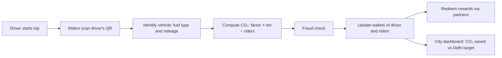

# 🌱 EcoSeat — Carbon Credits for Clean, Shared Commutes in Delhi

**Team Brahmastra** · The Corporate Glitch ’26 – Delhi Edition (Builders Hub × Paytm, Noida)
**Track:** Smart Cities & Urban Innovation

> **Status:** Concept and design stage. The working prototype will be built live at the Grand Finale on 21 November 2026. This README explains the idea, the math and the build plan.

---

## 📌 Problem Statement

Delhi’s commuters get no reward for sharing rides or travelling clean, and no penalty for driving alone in petrol cars. Without a per-person credit system, empty seats and road pollution keep growing.

**Why it matters**

- Delhi had **87.61 lakh motor vehicles** in 2025–26, up 7.9% in one year (Economic Survey of Delhi 2025–26).
- Vehicles cause roughly **half of Delhi’s locally generated PM2.5** (CSE analysis of IITM Decision Support System data).
- Current incentives reward **buying** an EV, not **how people travel every day**.
- A solo EV is treated as fully “clean”, but India’s electricity grid is still mostly coal-based, so even a solo EV causes about **109 g CO₂ per km**.
- Cars often run with empty seats, so emissions per person stay high.

---

## 💡 Our Solution: EcoSeat

EcoSeat is a **carbon-credit wallet** that scores every trip (car, two-wheeler, metro, bus, cycle or walk) by **CO₂ emitted per person per km**.

1. **Measure:** distance, vehicle type and number of riders, verified by QR and GPS.
2. **Score:** real emissions divided by the number of people travelling, including power-plant emissions for EVs.
3. **Reward:** every traveller gains or loses credits, redeemable for parking, EV charging, metro top-ups and tolls through partners.

The key idea: **we reward filled seats and clean modes, not just owning a certain type of vehicle.** A full petrol car can earn more than a solo EV.

---

## 🧮 How Credits Are Calculated

### The formula

```
Credits = (120 − g CO₂ per person-km) × km ÷ 10
```

| Part | Meaning |
|---|---|
| `120` | City target: the “allowed” grams of CO₂ per person per km. Set below a solo petrol car, so driving alone in petrol loses credits. Policymakers can lower it over time. |
| `g CO₂ per person-km` | Vehicle emission per km ÷ number of people travelling |
| `× km` | Longer trips count more |
| `÷ 10` | Keeps numbers small and readable |

Below the target → **earn credits**. Above the target → **lose credits**.

### Step 1: Emission per km of the vehicle

| Vehicle | Calculation | g CO₂ / km |
|---|---|---|
| Petrol car | 2.31 kg CO₂ per litre ÷ 15 km/L | **154** |
| Electric car | 0.15 kWh/km (incl. charging loss) × 0.727 kg CO₂/kWh | **109** |
| Petrol two-wheeler* | 2.31 kg CO₂/L ÷ 50 km/L | **46** |
| Electric scooter* | 0.03 kWh/km × 0.727 kg CO₂/kWh | **22** |
| Electric bus (per passenger)* | ~1.2 kWh/km × 0.727 ÷ ~30 passengers | **~29** |
| Metro (per passenger)* | Assumed, to be verified with DMRC data | **~20** |
| Walk / cycle | No fuel or electricity | **0** |

0.727 kg CO₂/kWh is India’s grid emission factor (CEA CO₂ Baseline Database, FY 2023-24, weighted average adjusted for renewables).
\* Starting assumptions for the prototype. They will be calibrated with official data.

### Step 2: Divide by the number of people

| Trip | Per-person emission |
|---|---|
| Petrol car, alone | 154 ÷ 1 = 154 g |
| EV, alone | 109 ÷ 1 = 109 g |
| Petrol car, 4 people | 154 ÷ 4 ≈ 39 g |
| EV, 4 people | 109 ÷ 4 ≈ 27 g |
| Petrol bike + pillion | 46 ÷ 2 = 23 g |

### Step 3: Credits for a 10 km trip

| Trip | g per person-km | Credits (each person) |
|---|---|---|
| Petrol car, alone | 154 | **−34** |
| EV, alone | 109 | **+11** |
| Petrol car, 4 people | 39 | **+81** |
| EV, 4 people | 27 | **+93** |
| Metro | ~20 | **+100** |
| Cycle / walk | 0 | **+120** |

**What this shows:** a solo EV earns only a little, a shared petrol car earns much more, and public transport, cycling and walking earn the most.

### Rules that keep it fair

- **Daily cap:** a maximum of 200 credits per person per day, so nobody drives around just to earn credits.
- **Real trips only:** a trip needs a start and end point, and trips under 1 km are ignored.
- **Negative balance:** loses partner discounts and can be linked to higher parking fees by partners or the city.
- **Everyone earns:** in a shared car, the driver and every rider receive the same credits.

---

## 🔄 How It Works



### Fraud check (rule-based, version 1)

A trip is flagged if:

- riders’ locations are more than 200 m apart at the start or end of the trip,
- the average speed is impossible (for example above 120 km/h in the city),
- the same group logs an unusually high number of trips in one day.

Later this can be replaced by a machine-learning anomaly model trained on real trip data.

---

## 🛠️ Tech Stack (for the 8-hour build)

| Layer | Tools |
|---|---|
| Frontend | Mobile-friendly web app with React + Tailwind CSS, html5-qrcode for QR trip join, Leaflet + OpenStreetMap for maps, Chart.js for the dashboard |
| Backend | Node.js + Express REST API |
| Database | SQLite (users, trips, credit ledger) |
| Core logic | Emission + credit engine, rule-based fraud check, city impact simulator |
| Mocked for demo | Vehicle registry (RC) data, GPS co-location, Paytm / UPI reward redemption |

### Planned API endpoints

| Method | Endpoint | Purpose |
|---|---|---|
| `POST` | `/api/trips/start` | Driver starts a trip and gets a QR code |
| `POST` | `/api/trips/:id/join` | Rider joins by scanning the QR |
| `POST` | `/api/trips/:id/end` | End trip, compute CO₂ and credits |
| `GET` | `/api/wallet/:userId` | Credit balance and trip history |
| `GET` | `/api/leaderboard` | Top users and companies |
| `POST` | `/api/simulate` | City impact: “what if X% of commuters switch?” |

### Data model

```
User        (id, name, company, credit_balance)
Vehicle     (id, owner_id, type, fuel, g_co2_per_km)
Trip        (id, vehicle_id, mode, km, start_time, end_time, status)
TripRider   (trip_id, user_id, joined_at)
CreditEntry (id, user_id, trip_id, credits, reason, created_at)
```

### Planned folder structure

```
ecoseat/
├── client/          # React web app (rider app + dashboard)
├── server/          # Express API
│   ├── engine/      # emission + credit calculation
│   ├── fraud/       # rule-based checks
│   └── db/          # SQLite schema and seed data
└── README.md
```

---

## 📈 Expected Impact

- **~80% less CO₂ per person** when a solo petrol commute becomes a 4-person EV ride (1.54 kg → 0.27 kg for a 10 km trip).
- **Fewer cars on the road:** 4 commuters in 1 car means less congestion.
- **City view:** a live dashboard of tonnes of CO₂ saved against Delhi’s target.
- **Corporate ESG:** companies can reward employees’ green commutes and use the data in sustainability reports.

---

## 🆚 How We Compare

| | Rewards sharing | Counts grid CO₂ | Daily incentive |
|---|---|---|---|
| Carpool apps | Cost split | No | No |
| EV purchase subsidy | No | No | One-time |
| Odd-even / bans | No | No | Penalty only |
| **EcoSeat** | **Yes, per rider** | **Yes** | **Every trip** |

---

## ⚠️ Challenges and Limitations

- **Fake carpools:** handled by QR join and rule-based checks; ML model later.
- **Vehicle data:** start with user-uploaded RC details; connect to registry APIs later.
- **Who funds rewards:** corporates (ESG commute programmes), parking and charging partners.
- **Privacy:** store trip summaries, not raw location history.
- **CO₂ vs local pollution:** credits currently use CO₂. Two-wheelers have low CO₂ per km but contribute heavily to Delhi’s PM2.5. A future version can add a PM2.5 weight per vehicle type.

---

## 🚀 Roadmap

- **Grand Finale (21 Nov 2026):** credit engine, QR trip join, wallet, leaderboard, city simulator.
- **Next:** React Native mobile app, real GPS matching, ML fraud model.
- **Later:** vehicle registry integration, Paytm / UPI rewards, partnerships with parking operators, charging networks and companies.

---

## 📚 References

- Central Electricity Authority, *CO₂ Baseline Database for the Indian Power Sector* (FY 2023-24 weighted average, RE-adjusted: 0.727 t CO₂/MWh).
- *Economic Survey of Delhi 2025–26*: 87.61 lakh motor vehicles; 522 vehicles per 1,000 people.
- CSE / Down To Earth analysis of IITM Decision Support System data: vehicles ≈ 51–53% of Delhi’s local PM2.5.
- Mogno et al. (2023), *Road transport impact on PM2.5 pollution over Delhi during the post-monsoon season*, Atmospheric Environment: X.
- A-PAG, IIT Delhi & TERI report on interstate truck emissions in Delhi.

---

## 👥 Team Brahmastra

- **Gunjan Baid**
- **Suneet Bhardwaj**

Bharati Vidyapeeth’s College of Engineering

---

## 🤖 AI Tools Disclosure

Claude (Anthropic) was used to help research, draft the presentation and write this README, as required by the hackathon rules.
